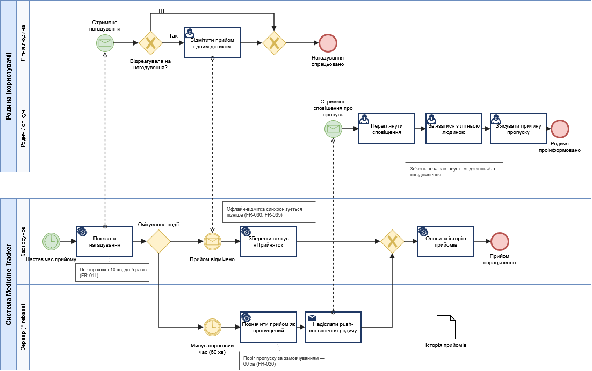

_**Elder Med Tracker💊 - Застосунок для нагадування про прийом ліків і щоденного обліку самопочуття літніх людей.**_

Простий інтерфейс із великими елементами допомагає відмічати прийом одним дотиком, а родичі чи опікуни отримують сповіщення, якщо прийом пропущено.
Історію прийому та самопочуття можна експортувати для лікаря.

**Моделі процесів**

BPMN-діаграма основного процесу «Контроль прийому ліків і сповіщення родича про пропуск»: 

Редагована версія: [bpmn_process.drawio](docs/diagrams/bpmn_process.drawio).
